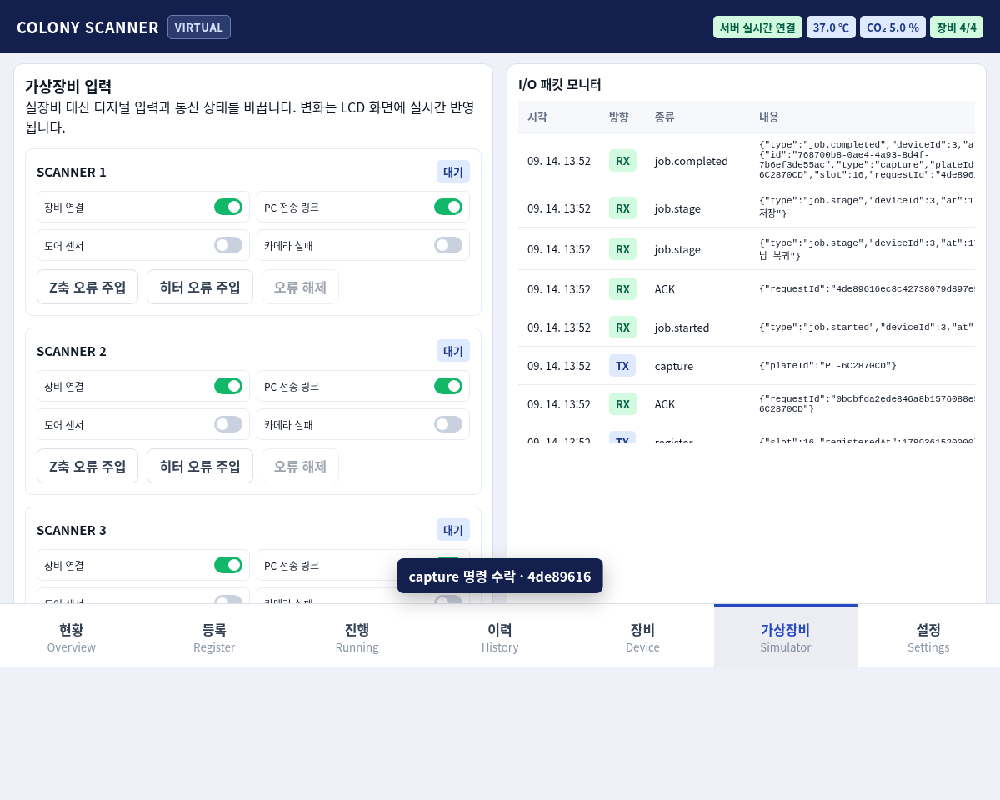

# Colony Scanner React + Virtual Device Demo

UI 시안과 `CC_LCD_UI_Spec_v1.1_260911.docx`를 기준으로 만든 React 19 애플리케이션입니다. UI와 장비 상태를 분리했으며, Node.js 가상장비 서버가 스캐너 4대의 입력·출력과 작업 상태를 관리합니다.



## 실행

```sh
cd /home/miru/cc-lcd/react-demo
./run-demo.sh
```

브라우저에서 `http://127.0.0.1:8787`을 엽니다. 개발할 때는 `npm run dev`를 실행하고 `http://127.0.0.1:5173`을 사용합니다.

데이터는 `data/state.json`, 합성 촬영 영상은 `data/images/`에 저장됩니다. 서버를 재시작해도 등록·촬영·반출·이력·설정이 유지됩니다.

## 구성

- `src/`: React LCD UI. 현황, 등록, 진행, 이력, 장비, 가상장비, 설정 화면
- `server/virtual-device.mjs`: 가상 스캐너 4대, 센서·액추에이터·촬영 단계
- `server/controller.mjs`: 명령 검증, 상태 저장, 영상 5장 보존, ACK/NACK와 I/O 기록
- `server/index.mjs`: HTTP API, Server-Sent Events 실시간 상태, 합성 영상, 프로덕션 UI 제공

UI는 `/api/events`를 통해 서버 상태를 실시간 구독합니다. 명령은 `/api/commands`에 `requestId`, `command`, `deviceId`, `args`를 보내며, 중복 요청 ID는 동일 명령일 때만 재사용됩니다.

## 가상장비 사용

1. `가상장비` 탭에서 장비 연결, PC 전송 링크, 도어 센서, 카메라 실패 입력을 바꿉니다.
2. Z축·히터 오류를 주입하거나 해제합니다.
3. `등록`에서 빈 슬롯을 선택해 플레이트를 등록합니다.
4. 상세의 `지금 촬영`으로 6단계 가상 사이클을 실행합니다.
5. `진행`에서 Z축 위치, 조명, 히터 출력과 진행률을 봅니다.
6. I/O 패킷 모니터에서 TX, ACK/NACK, 단계 이벤트를 확인합니다.

PC 링크를 끊은 상태에서 촬영하면 영상은 서버에 보유되지만 미전송으로 표시됩니다. 링크 복구 후 상세 화면에서 재전송할 수 있습니다. 카메라 실패나 도어 열림은 작업 실패와 인터록을 발생시킵니다.

## 실장비 연결 시 경계

현재 `VirtualDeviceAdapter`가 가상 입력과 출력을 담당합니다. 실장비 연결은 같은 `snapshot()`, `command()`, `event` 계약을 구현하는 어댑터로 교체하면 React UI와 컨트롤러의 상태·명령 형식을 유지할 수 있습니다. 실제 통신 규격과 SDK가 제공되면 Modbus TCP, 시리얼, 제조사 SDK 등의 어댑터를 이 경계에 추가해야 합니다.

이 데모는 물리 모터·히터·카메라를 제어하지 않습니다. 비상 정지와 인터록은 가상 상태에만 적용됩니다. 실장비 적용 전에는 PLC/컨트롤러 자체의 하드웨어 인터록, 타임아웃, 인증, 감사 로그를 별도로 검증해야 합니다.

## 검사

```sh
npm run check
```

서버 검사는 등록, 중복 명령, 슬롯 충돌, 촬영, 일시정지, 최근 영상 5장, PC 링크 단절·재전송, 도어 인터록, 카메라 실패, 반출과 재시작 복구를 검증합니다. UI 검사는 SSE 연결, 오류 입력·복구, 등록, 촬영, I/O 모니터를 Chromium에서 검증합니다.

## 문서

- [전체 시스템 명세](docs/SYSTEM_SPEC.md)
- [운영자 사용설명서](docs/USER_GUIDE.md)
- [저장소 작업 방식](docs/GITHUB_WORKFLOW.md)
- [코딩 규칙](docs/CODING_RULES.md)

## 저장소 작업 방식

개발 작업은 Issue에서 시작하고 기능 브랜치와 Pull Request를 통해 `main`에 반영합니다. 자세한 규칙은 `CONTRIBUTING.md`와 `docs/GITHUB_WORKFLOW.md`를 따릅니다.
